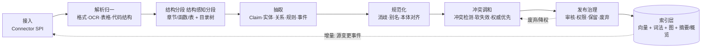
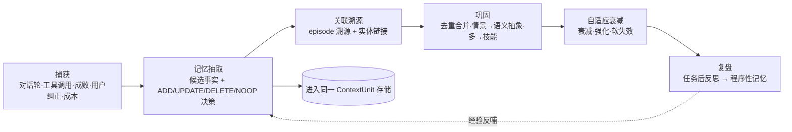
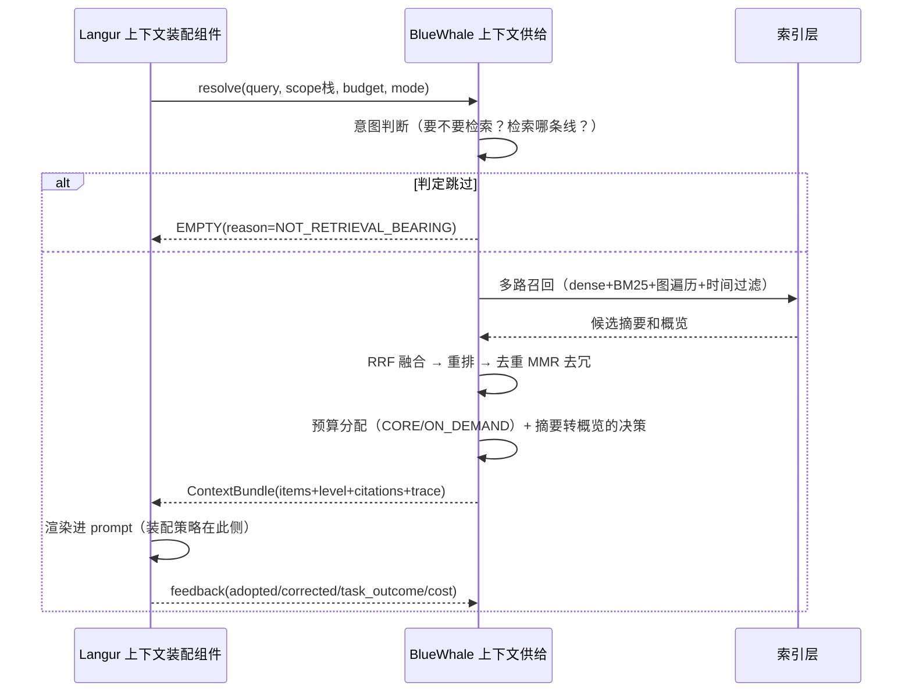
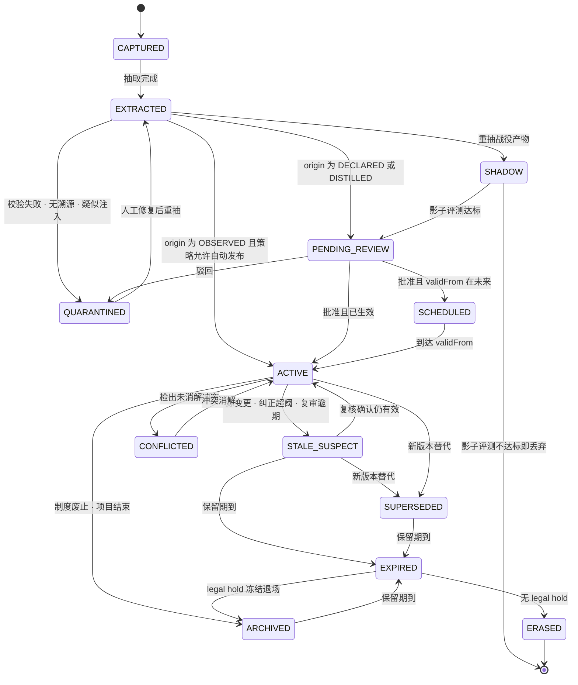

# BlueWhale Context 框架：总体设计

BlueWhale 当前代码以记忆管理为主。目标是在同一套服务中管理知识和记忆，并根据实际使用情况持续修订内容。

本文说明模块分工、数据存储、发布与销毁方式，以及分阶段实施计划。接口和表结构见 `ARCHITECTURE-DETAILED-DESIGN.md`；知识出错后的归因与修订流程见 `KNOWLEDGE-CLOSED-LOOP-DESIGN.md`。

---

## 1. 为什么要从记忆框架升级为 Context 框架

### 知识和记忆可以共用存储，但需要不同的治理方式

知识通常是共享、需要审计、描述外部事实的内容；记忆通常是私有、会过期、描述使用经历的内容。对 Agent 来说，两者都是以后需要保存、更新和召回的上下文，因此可以共用存储、ID 和检索入口，再通过属性区分治理方式，不必建设两套数据库。

业界也在采用类似方案。OpenViking 把 Memory、Resource、Skill 放入同一个 `viking://` 虚拟文件系统，并提供分层检索 [1](https://github.com/volcengine/OpenViking)[7](https://www.cnblogs.com/itech/p/22954030)；Zep 使用 Context Graph 描述这类统一上下文 [5](https://blog.51cto.com/wangshiyu/14874426)。

### 上下文供给需要控制成本

不能把检索到的内容全部放进 prompt。身份和当前任务需要优先保证，长期记忆和知识按需加载，事件记录主要用于追溯和再加工 [2](https://blog.csdn.net/LLM_9528/article/details/165333690)。OpenViking 通过摘要、概览、原文三级内容减少输入 token [1](https://github.com/volcengine/OpenViking)。实现时应先判断是否需要展开，再读取详细内容，而不是先加载全文再压缩。

### 评测要看任务收益

LoCoMo 的评测结果表明，长上下文模型仍可能误解时序和因果，普通 RAG 对多跳问题也有限 [4](https://blog.csdn.net/Python_cocola/article/details/162882604)。MERIT 进一步把任务成功率、token 成本和记忆污染纳入评测 [3](https://www.aminer.cn/pub/aa0ad370a96f8c83c8115ea)。因此，本框架主要比较有无上下文时的任务成功率和成本，不以公开榜单分数作为唯一目标。

### 知识必须支持更新和失效

知识生命周期包括采集、解析、抽取、规范化、实体消歧、融合、审核、发布、检索、反馈、更新和废弃。曾经正确但已经失效的内容，往往比明显错误更难发现，因此必须记录版本、时间、来源、权威级别、有效期和访问权限 [6](https://m.blog.csdn.net/xian_wwq/article/details/165227242)。Graphiti 通过现实时间、系统时间和软失效保留历史状态 [5](https://blog.51cto.com/wangshiyu/14874426)[8](https://justin3go.com/posts/2026/06/04-agent-memory-architecture-guide)，本设计采用同样的基本思路。

升级后，BlueWhale 的管理对象从一条记忆扩展为一份上下文资产，能力从存取和遗忘扩展为加工、治理、供给和持续更新。


---

## 2. 现状基线（代码事实，方案的所有改动都锚定在这里）

| 事实 | 位置 | 后果 |
|---|---|---|
| 只有内存实现，无真持久化 | `InMemoryMemoryRepository` / `InMemoryGraphRepository` / `InMemoryVectorStore` | 重启后数据丢失，衰减、归因和成本统计无法长期使用 |
| 单 collection 压平三种表征 | [Memory.java](file:///Users/cn-artisanzhou/Library/Mobile%20Documents/com~apple~CloudDocs/Documents/Agent/Framework/BlueWhale/src/main/java/org/skylark/bluewhale/domain/model/memory/Memory.java) + `MemoryType` 四值枚举 | 难以按时序、关系和文档类型选择检索方式 |
| "抽象进化"是字符串拼接 | [MemoryEvolutionService.java:81-100](file:///Users/cn-artisanzhou/Library/Mobile%20Documents/com~apple~CloudDocs/Documents/Agent/Framework/BlueWhale/src/main/java/org/skylark/bluewhale/domain/service/MemoryEvolutionService.java#L81) 取每条前 30 字符拼成"语义记忆" | 当前实现没有生成新的语义内容 |
| 衰减只看访问时间 | [MemoryMetadata.java:47](file:///Users/cn-artisanzhou/Library/Mobile%20Documents/com~apple~CloudDocs/Documents/Agent/Framework/BlueWhale/src/main/java/org/skylark/bluewhale/domain/model/memory/MemoryMetadata.java#L47) `exp(-decay·天)` | 无法根据采纳和纠正记录调整记忆 |
| 无有效期、无溯源、无作用域 | 全模型缺 `valid_to` / `supersedes` / `scope` / `citation` | 发生冲突时缺少裁决依据，也无法按历史时点查询 |
| 只有向量单路召回 | [MemoryDomainService.java:52](file:///Users/cn-artisanzhou/Library/Mobile%20Documents/com~apple~CloudDocs/Documents/Agent/Framework/BlueWhale/src/main/java/org/skylark/bluewhale/domain/service/MemoryDomainService.java#L52) `recallSimilar` | 无词法、无图、无时间、无重排 |
| 领域层直接依赖基础设施端口 | `MemoryDomainService` import `infrastructure.embedding/vectorstore` | 违反自身宣称的六边形架构 |
| 无人调用 | Langur/Skylark 源码中 `bluewhale` 引用数 = 0；仅 README 互链 | 当前接口没有实际调用方 |

Langur 已有上下文消费端，以下能力可以复用，但需要明确职责边界：

- `ContextAssembler.assemble(traceId, bizCode, agent, tokenBudget)` → `AgentContext`（四级 `MemoryLevel`：瞬时、会话、任务、知识 + Token 预算分配制 + 脱敏链），[DefaultContextAssembler.java:29](file:///Users/cn-artisanzhou/Library/Mobile%20Documents/com~apple~CloudDocs/Documents/Agent/Framework/Langur/langur-infrastructure/src/main/java/org/skylark/langur/infrastructure/harness/context/DefaultContextAssembler.java#L29)
- 向量检索组件：`VectorMemoryService`（Top-K + 预算截断 + 可选重排 + 混合检索）、PgVector / Elasticsearch / Milvus / memory 四实现、RRF 融合、`EmbeddingRerankPort`、namespace 租户隔离、`SecretResolver`/`SsrfGuard`、启动维度一致性 fail-fast
- RSI 侧 `MemoryDistiller` 已把轨迹写进长期记忆；`KnowledgeIngestTool` / `KnowledgeRetrievalTool` 把知识暴露成 agent 工具（仅文本入，无分段/解析）
- 断点：装配出的 `AgentContext` 落了仓储但没回到调用链——实际进模型的是 `AbstractOpenAICompatibleLLMAdapter.decide(systemPrompt, model, conversationHistory, availableTools)`，长期记忆从未自动注入

结论：BlueWhale 缺的不是"再写一套向量检索"，而是 Langur 没有的那个"上游"——加工、治理与闭环。上下文工程在链路里位于 RAG 与装配的上游，它决定 Agent 能知道什么、以什么结构表示、带哪些治理信号 [9](https://atlan.com/know/context-engineering/context-engineering-for-rag-agents/)。

---

## 3. BlueWhale 与 Langur 的职责边界

```
┌──────────────────────────── Langur（消费端 · 策略） ───────────────────────────┐
│ 上下文装配组件 ContextAssembler：预算分配 · 注入顺序 · 渲染 · Hook/脱敏 · 最终传给 LlmGateway │
└──────────────────────────────────┬──────────────────────────────────────────┘
                       契约：ContextBundle（CORE / ON_DEMAND / LEDGER + citations + trace）
┌──────────────────────────────────┴──────────────────────────────────────────┐
│                BlueWhale（基座 · 机制）＝ 本文档范围                            │
│  ┌── 知识工程 ──┐   ┌── 记忆工程 ──┐   ┌── 上下文供给 ──┐    ┌── 闭环 ──┐ │
│  │ 接入·抽取·融合  │   │ 捕获·提炼·巩固   │   │ 门控·混合检索  │  │ 埋点·归因 │ │
│  │ 治理·发布·废弃  │   │ 衰减·失效·复盘   │   │ 分层·重排·渲染 │  │ 评测·调权 │ │
│  └────────┬────────┘   └────────┬────────┘   └────────┬───────┘  └────┬───┘ │
│           └───────── 一套 ContextUnit 存储 + 三索引 + 一张图 ────────────┘      │
└─────────────────────────────────────────────────────────────────────────────┘
```

- BlueWhale 拥有写路径与治理（ingest / extract / consolidate / reconcile / decay / govern），以及供给 API `resolve()`；它不拼 prompt。
- Langur 拥有装配策略（预算、顺序、渲染、hook、把结果传给模型）；它不做加工与生命周期。
- 重叠处置：Langur 的四个向量实现抽成 `RetrievalBackend` SPI（或下沉为共享库 `skylark-index`），由 BlueWhale 的 `IndexPort` 复用；`VectorMemoryService` / `Knowledge*Tool` 过渡为 BlueWhale 客户端。严禁双写。
- client 端不止 Langur：另有独立管理端（知识治理 / 记忆管理 / 生命周期看板，知识工程与管理端阶段）作为第二个 client，经治理 API 面操作服务端；工程形态上 BlueWhale = server（默认），Langur 与管理端 = client（见 第 13.1 节）。
另外两种方案没有采用：
- 将装配层并入 BlueWhale：需要重做 Langur 的生命周期钩子、画像和 Token 治理，也会把上下文供给与 Agent 执行耦合在一起。
- 将知识和记忆能力并入 Langur：落地较快，但难以复用到 Skylark 和第三方 Agent，权限与审计边界也不清晰。

当前选择职责分离，与 OpenViking 将上下文基础设施独立于 Agent 框架的方式一致 [1](https://github.com/volcengine/OpenViking)，同时可以复用 Langur 已有的向量检索能力。

---

## 4. 概念模型：ContextUnit、七个属性和三条表征线

不要用一个 `type` 枚举切分一切。 现状的 `MemoryType` 降级为其中一个 facet：

| facet | 取值 | 决定什么 |
|---|---|---|
| `kind` | EPISODIC / SEMANTIC / PROCEDURAL / WORKING | 认知分类，影响巩固与是否可遗忘 |
| `origin` | DECLARED（人工/系统权威写入）· OBSERVED（对话或事件抽取）· DISTILLED（多记忆聚合）· EXECUTED（轨迹/工具沉淀） | 治理强度：审核要求、可信度上限、失效策略 |
| `scope` | `workspace ⊐ project ⊐ agent ⊐ user ⊐ session` 栈，就近覆盖 | 可见性、共享边界、冲突时的权威优先级 |
| `lifecycle` | 状态机 state + 四条时间轴（现实轴 / 系统轴 / 采集轴 / 治理轴）+ owner + retentionPolicy | 这条知识当前处于哪个状态、谁为它负责、何时该复审、何时该退场。详见 第 14 节 |
| `resolution` | 摘要（约 100 token）/ 概览（约 2k token）/ 原文 | 成本旋钮，检索只读取摘要和概览，原文按需展开 |
| `economy` | 长度/成本、`nSeen / nCited / nAdopted / nCorrected`、confidence、authority | 排序权重、retention、是否晋升或废弃 |
| `lineage` | 派生链：`source → segment → claim → distilled → skill`，含 `derivedAt` 与 `extractorVersion` | 变更传播与影响分析的前提，详见 第 14.4 节 |

外加两条必须存在的字段：`provenance`（unit → 来源 episode → 原文 span，可引用可回溯）与 `edges`（`SUPPORTS / CONTRADICTS / SUPERSEDES / DERIVED_FROM / ABOUT / PART_OF / PRECEDED_BY`，每条边带时间戳）。

三条表征线，同一份历史（这是当前模型要拆开的核心）：

```
                    同一 Episode 流（只增不改，写满不读回）
                            │
        ┌───────────────────┼───────────────────┐
   事件时间线           实体-关系图           精炼文档层
   episodic timeline   entity/relation      curated doc / skill
   时序·因果·谁在何时    KG + bi-temporal      可长读、可呈现、
   做了什么             fact 边有效期          可版本化发布
        │                   │                   │
        └──── 意图门控按查询选择时间线、关系图、文档层或组合 ────┘
```

依据：把"事件时间线 / 实体-事件图 / 精选文档记忆"三件事分开建模、检索时做意图门控 + 来源路由 + 三路并发 agentic 搜索，是 2026 年 LongMemEval 95.6% 的方案要点——它"分离了通常被记忆系统揉成一体的三件事" [11](https://aihot.virxact.com/items/cmtjfnzqs05frrobvwpmq4s9c)；OpenViking 用 resource/memory/skill 三分达到同样效果 [1](https://github.com/volcengine/OpenViking)。

---

## 5. 知识工程的处理流程



实现时需要注意以下几点：

1. 增量优先，不全库重算：监听 binlog / 文件夹 / Webhook → 新增文档自动切片 → embedding → upsert；图谱增量演化走"新实体关系识别 → 低代码人工审核 → 合并入主图" [12](https://m.zhongjisaiwei.com/pd.jsp?groupId=16&pid=1199&sortName=addedTime)。Graphiti 明确以"持续增量加入已有 Context Graph"为设计前提 [5](https://blog.51cto.com/wangshiyu/14874426)。
2. 摘要先行 + 目录树：每个语义处理过的目录自动生成 `.abstract`(摘要) 与 `.overview`(概览)，Agent 决策链变成"读 摘要 判相关 → 读 概览 判要不要细节 → 才读 原文" [1](https://github.com/volcengine/OpenViking)。这要求 结构分段 的分段保留层级（不是扁平 chunk）。
3. 冲突 ≠ 覆盖：新事实与旧事实矛盾时，旧边打 `expired_at=now` + `invalid_at=新事实 valid_at`，不删除；于是"现在为真"和"某时刻系统认为什么为真"两种查询都成立 [8](https://justin3go.com/posts/2026/06/04-agent-memory-architecture-guide)。
4. 抽取是有风险的步骤，必须限定作用域隔离：事实抽取会抽错、过度概括、丢限定条件；`user_id/agent_id/run_id` 与元数据严格隔离否则记忆串人 [13](https://m.blog.csdn.net/EnjoyEDU/article/details/164621222)。
5. 图谱克制、路由分流：开放域闲聊与创意写作里图谱反而是束缚，应有智能路由网关只在知识密集型查询启用 GraphRAG [14](https://cloud.tencent.com.cn/developer/article/2703033)；图谱 Schema 必须可解释、可审计、可演进。
6. 注入前先渲染：原始三元组对模型与人都不友好，注入 prompt 前转成自然语言摘要/表格/路径描述 [14](https://cloud.tencent.com.cn/developer/article/2703033)。
7. 检索内容是攻击面：外部文档带来的指令注入必须按不可信输入处理——trust tier + quarantine，并与 Langur 的 `PromptInjectionGuardHook` 形成两道闸（基座一道、装配一道）。
8. 质量口径：查询重写(HyDE/多查询融合) → 后处理(Cross-Encoder 重排、MMR 去冗) → 上下文选择性压缩 → 指标 Recall@K / MRR / NDCG@K + 忠实度/幻觉率 + TTFT [12](https://m.zhongjisaiwei.com/pd.jsp?groupId=16&pid=1199&sortName=addedTime)。

> 当前设计（见 第 15 节 与 `KNOWLEDGE-CLOSED-LOOP-DESIGN.md`）：知识处理流程不再是单向管线。抽取/规范化 的输出单位改为 WikiPatch（md diff），发布 之前统一经 ChangeRequest 闸门；其后追加闭环阶段 Distill（萃取），把使用信号归因后回流为变更单。抽取 对每条 claim 标注权威等级 源文/推导/专家/复盘，源文级必须带 evidenceSpan 并通过原文逐字校验，失败降级而非静默入库。

---

## 6. 记忆工程的处理流程



- 记忆抽取的 ADD/UPDATE/DELETE/NOOP 是记忆写入的核心决策，而不是无条件 append：写入时与既有记忆比对，由模型判定新增/更新/删除/无操作（Mem0 路线，token 效率优先 [10](https://leetcode.cn/circle/discuss/oCLr28/)）。同时保留 episode 原文做溯源，抽取出的关系可回溯到"哪一段输入产生的" [13](https://m.blog.csdn.net/EnjoyEDU/article/details/164621222)。
- 巩固阶段需要替换当前的字符串拼接实现：[MemoryEvolutionService.java:81](file:///Users/cn-artisanzhou/Library/Mobile%20Documents/com~apple~CloudDocs/Documents/Agent/Framework/BlueWhale/src/main/java/org/skylark/bluewhale/domain/service/MemoryEvolutionService.java#L81) 改为"相似聚类 → 模型蒸馏（推理模型 REASONING + 结构化输出）→ 生成 DISTILLED 单元并挂 `DERIVED_FROM` 边"；`importance` 不再靠 `accessCount>3` 硬编码，而由 `economy` facet 的采纳/纠正信号驱动。
- 衰减阶段保留一个正确的既有决策：程序性记忆不参与遗忘（[同文件:37](file:///Users/cn-artisanzhou/Library/Mobile%20Documents/com~apple~CloudDocs/Documents/Agent/Framework/BlueWhale/src/main/java/org/skylark/bluewhale/domain/service/MemoryEvolutionService.java#L37)），技能只降权不删。
- 复盘阶段用于从任务轨迹中提取可复用的做法：任务结束后对轨迹做反思，产出可复用的程序性记忆（对应 Letta/Skill 生态把"怎么做"独立成一类上下文 [1](https://github.com/volcengine/OpenViking)）；Langur 已有 `MemoryDistiller` 雏形，应改为向 BlueWhale 提交而不是由 Langur 自行保存到长期记忆。

---

## 7. 知识与记忆如何互相转化

这是"知识 + 记忆"合到一个框架才可能出现的价值，也是绝大多数单体记忆系统没有的一环：

| 方向 | 触发条件 | 动作 | 治理 |
|---|---|---|---|
| 晋升 Promotion（私有经验 → 共享知识） | DISTILLED 单元跨 ≥N 个 agent/user 被反复召回，采纳率 > 阈值，纠正率 < 阈值 | 生成 `origin=DISTILLED, scope=project/workspace` 候选知识单元 | 必须过审核闸门（人审或双模型互检），带 authority 标记发布 |
| 降权 Demotion（共享知识 → 存疑） | 该知识被使用后频繁伴随纠正 / 命中冲突 / 源已变更 | 打 `STALE_SUSPECT` → 降权 → 触发 reconcile 或送人工 | 不直接删（判断失效比判断错误代价更高） |
| 冷启动 Bootstrap（知识 → 记忆骨架） | 知识库实体/本体提供挂载点 | 记忆抽取时做实体链接，让经验挂在实体上而非漂浮 | 无 |

于是端到端闭环成立：

```
用 → 记 → 炼 → 晋升 → 共享 → 更多人用 → 再记再炼 → 质量随使用和审核持续改进
```

---

## 8. 供给面：`resolve()` —— 分层按需 + 意图门控



读路径需要遵守以下约束：

1. 默认读路径 0 次 LLM 调用（门控用规则 + 轻量模型，重排用 重排/调和模型 或向量+词面混合）；多跳 agentic 深检索是显式工具 `explore/expand`，异步且记账。
2. EMPTY 是正确答案。证据不足/权限不足/冲突未决时返回空 + 原因码，不凑数注入——这是把 LoCoMo 对抗类"幻觉"堵在门口 [4](https://blog.csdn.net/Python_cocola/article/details/162882604)。
3. 装载三预算：CORE（身份/任务，总是满载）、ON_DEMAND（长期记忆/知识，按需）、LEDGER（事件账本，只写不读，供再加工与审计）[2](https://blog.csdn.net/LLM_9528/article/details/165333690)。
4. 全链路 trace 可回放：OpenViking 把"检索轨迹完整可追溯、非黑箱"作为对传统向量库的本质差异 [7](https://docs.openviking.ai/zh/faq/faq)；没有 trace，归因和调参都无从谈起。
5. 权限在召回前生效，不是召回后再过滤（避免把不该见的摘要送进排序器）。

接口面：REST + Java SDK + MCP server（`context_search / context_read / context_explore / context_commit / context_feedback / knowledge_ingest`），URI 命名空间 `bluewhale://{tenant}/{scope}/{kind}/{path}`，可 `ls/tree/grep/find` 浏览。MCP 用于支持非 Java 调用方和第三方 Agent，让 Langur、Skylark、乃至任意第三方 Agent 都能接。

---

## 9. 评测与发布检查

三层指标，缺一不可：

| 层 | 指标 | 口径 |
|---|---|---|
| 检索层 | Recall@K / MRR / NDCG@K | 离线题库，逐条标注 |
| 供给层 | 注入采纳率、citation 命中率、EMPTY 正确率、token/任务、p95 延迟 | 线上埋点 |
| 结果层 | 有/无上下文的任务成功率 lift、纠正率、忠实度/幻觉率、成本 | 影子回放 + A/B + leak-check |

做法：
- 公开题库做回归基线：LoCoMo / LongMemEval(-S) 子集；对抗类（cat5）单列，不要混进总分——它会把整体分数挪动 10 分以上 [15](https://www.maximem.ai/evals)[16](https://mem0.ai/library/agent-memory/ai-memory-benchmarks-in-2026)。
- 自建任务型题库：MERIT 风格，验证依赖关系、含"事实被更新"梯度、含记忆腐蚀注入，并对每个记忆操作做 token/美元计量 [3](https://www.aminer.cn/pub/aa0ad370a96f8c83c8115ea)。
- 治理看板：覆盖率（多少真实任务用上了上下文）、陈旧率（已过期仍被召回的比例）、冲突积压、审核队列时长、成本分布。
- 新抽取模型 / 新分段策略上线 = 必过离线回归 + 影子回放，把评测做成闸门而非事后复盘 [9](https://atlan.com/know/context-engineering/context-engineering-for-rag-agents/)。
- 评测集从使用中长出来。每个被确认的缺陷必须沉淀为一条回归用例（`bw_regression_case`），ChangeRequest 没有新增用例不得进入 READY。发布闸门三层：缺陷回归集（必须 100% 通过）、基线集（Recall@K 回落不超容差）、影响面 trace 重放（未声明的差异视为副作用）。默认只重放检索与供给，不调 LLM；端到端 LLM 评测为可选项，须用独立模型并双跑。

---

## 10. 落地路线（每阶段带退出标准）

| 阶段 | 范围 | 退出标准 |
|---|---|---|
| 地基与契约（1 周） | 确定 BlueWhale 与 Langur 的职责边界；`ContextUnit` 聚合模型 + PG/pgvector DDL 替换全部 InMemory 仓储；把 `MemoryDomainService` 的端口下沉到 domain；REST+SDK 打通 Langur `DefaultContextAssembler`，并修 `AgentContext → LlmGateway` 断链 | Langur 一次真实调用带上 ≥3 条 BlueWhale 召回；token 增量可测；重启不丢数据 |
| 上下文读路径（2–3 周） | 多路召回 + RRF + 重排 + MMR；摘要、概览和原文分层生成；意图门控；EMPTY 语义；trace 可回放 | 自建 30 题集 Recall@5 立基线并优于纯向量对照；默认路径 LLM 调用数 = 0；p95 < 300ms |
| 记忆闭环（2–3 周） | 捕获事件流；LLM 抽取 + ADD/UPDATE/DELETE/NOOP；bi-temporal 软失效；基于模型的巩固与抽象；使用埋点与 unit 级归因 | LongMemEval-S 子集出分；"Java→Go"冲突用例答对且可回溯历史为真 |
| 知识工程与管理端（3–4 周） | Connector SPI；结构感知分段 + 目录树；claim/实体/关系抽取 + 消歧；图增量 + 审核发布；GraphRAG 路由；权限/保留策略 | 仓库级 20 题多跳达标；增量更新延迟 SLA；一次失效演练（源改后 N 分钟内不再召回旧事实） |
| 知识转化与持续评测（2 周） | Promotion/Demotion 闸门；benchmark 进 CI；治理看板；MCP server 上线 | 至少 1 条记忆经审核晋升为共享知识并被第二 agent 采纳；CI 有回归门禁 |
| 按需扩展 | 多租户 ABAC、legal hold、跨 agent 共享市场、嵌入/重排模型可插拔评测 | — |

工程约束（沿用 Langur 的现有约束）：端口在 domain、适配在 infra；`SecretResolver` 取密钥、`SsrfGuard` 校验地址、namespace 强制隔离、维度一致性 fail-fast、store 不可用 fail-fast 而非静默转内存。

> 生命周期任务已并入各阶段，具体安排见第 14.11 节。状态机、四条时间轴、血缘和删除墓碑必须在地基阶段建立。

---

## 11. 实施风险与取舍

1. 首先需要避免双写：Langur 与本框架各持一套 长期记忆存储与召回，会同时得到两份不一致的数据。必须先 SPI 化、再迁移，过渡期 BlueWhale 直接复用 Langur backend。
2. 不要一开始就上完整知识图谱：bi-temporal 图建模开销大、延迟高，业界明确不建议把它当唯一主层，而是与轻量记忆层并存 [10](https://leetcode.cn/circle/discuss/oCLr28/)。先做 claim 级双时态 + 轻量实体链接，完整 KG 放知识工程与管理端阶段。
3. 写路径异步化：LLM 抽取贵且慢，走队列 + 批量 + 去抖；读路径应尽量保持低成本。
4. 持久化需要尽早替换：否则衰减、归因、成本统计和评测都缺少可信数据。
5. 不以榜单分数作为目标：厂商自报口径差异极大（同一题集不同系统相差 20 分是常态），跨厂商横评要标注配置与偏差 [15](https://www.maximem.ai/evals)。只比较自身任务的提升。
6. 治理工作不显眼，但决定能否上生产：version/provenance/validity/authority/access 是地基阶段–记忆闭环阶段的主线，不是按需扩展阶段的补丁 [6](https://m.blog.csdn.net/xian_wwq/article/details/165227242)。

---

## 12. 决策记录

| 决策 | 结论 | 状态 |
|---|---|---|
| BlueWhale 与 Langur 分工 | BlueWhale 负责加工、存储、生命周期和 `resolve()`；Langur 负责预算、渲染、注入和 hook | 已定，2026-10-17 |
| 共享索引库 | 将 Langur 的向量端口和实现下沉为 `skylark-index`，两个项目共用，避免双写 | 已定，2026-10-17 |
| 抽取技术栈 | 默认使用 Java，复用 Langur 的模型矩阵和 `LlmGateway`；确有生态必要性时再评审 Python 边车 | 已定，2026-11-06 |
| 销毁与合规 | 默认软失效，硬删除走受控 erasure；legal hold 阻断普通擦除，备份恢复后先重放删除墓碑 | 工程方案已定；hold 条件和备份期限由法务确认 |
| 生命周期建设时间 | 状态机、四条时间轴、owner、血缘和事件表在地基阶段实现，自动化策略后续补齐 | 已定，2026-11-06 |
| 本体分层 | 分为框架内置、领域插件和项目术语表；规则发布前必须绑定 `binds_property` | 已定，2026-11-06 |
| Schema 载体 | 使用外置 YAML，与 Wiki 同仓库版本化，通过启动校验和 CI 检查 | 已定，2026-11-06 |
| 术语表维护 | LLM 从金标准归纳候选，人工裁决后入库；新类型进入 `PROPOSED` 队列 | 已定，2026-11-06 |
| Markdown 知识真源 | Markdown 是真源，ContextUnit 和索引是编译产物；变更使用 md diff，运行时数据不回写 Markdown | 已定，2026-11-06 |
| 知识更新闭环 | 采用提取、使用、萃取、更新流程；所有写入经过 ChangeRequest，确认缺陷进入回归集，系统草稿必须人审 | 已定，2026-11-06 |

聚类立单阈值和时间窗口使用历史数据标定，标定前不开自动立单。默认只重放检索与供给，需要端到端 LLM 评测时使用独立模型双跑。


---

## 13. 工程结构与核心契约

### 13.1 部署形态：Client/Server（Server 默认，embedded 降级）

工程架构 top-level 分成 client 端与 server 端；server 内部沿用 Langur 的 DDD 分层（interfaces → application → domain → infrastructure，见 第 13.2 节）。

| 形态 | 用法 | 地位 |
|---|---|---|
| Server（服务模式，默认） | Spring Boot jar + REST + MCP server + 管理端 API，服务 Langur、Skylark、第三方 IDE Agent、跨语言消费者、管理端 | 从地基阶段起作为主要部署方式 |
| Embedded（库模式） | Langur 依赖 `bluewhale-core` + `bluewhale-index-spi`，同进程 DI 调用 | 单机测试 / 小规模，降级为可选项 |

同一套 domain/application 代码，两种装配入口（`@AutoConfiguration` 分别提供）。Server 为默认：跨语言消费者与独立管理端天然需要进程边界；读路径 p95 < 300ms 由就近部署的 server 或同进程 embedded 满足。embedded 保留给单机测试与小规模场景，不再承担主路径职责。

### 13.2 模块与包拓扑

```
client/（独立，非 BlueWhale Maven 模块）
├── Langur Agent runtime        # 消费 ContextBundle + 提交捕获信号/反馈（SDK/DI 或 REST/MCP）
├── 管理端（知识工程与管理端阶段）                # 知识治理 · 记忆管理 · 生命周期看板（走 REST/MCP/管理端 API）
└── 第三方 / 跨语言消费者        # REST / MCP

skylark/（server 端）
├── bluewhale-starter/         # Server 默认装配入口（REST + MCP + 管理端 API）；embedded 装配
├── skylark-index/             # 共享索引库：向量/混合检索端口 + 4 实现（自 Langur 下沉）
├── bluewhale-core/            # domain：ContextUnit·图·生命周期·治理·评测口径（零框架依赖）
├── bluewhale-app/             # application：六个用例服务 + 七个周期 job + 端口实现装配
├── bluewhale-index-adapter/   # 实现 bluewhale 的 IndexPort，委托 skylark-index
├── bluewhale-store-postgres/  # 元数据 + pgvector 持久化（替换全部 InMemory 仓储）
├── bluewhale-extract/         # ExtractionPort 适配（LLM 抽取/蒸馏/重排，抽取/嵌入模型/重排/调和模型/推理模型）
├── bluewhale-client/          # 远程薄 SDK（Agent runtime 与 管理端共用）
└── bluewhale-interfaces/      # REST + MCP + 管理端 API
```

地基阶段允许先用单模块 + 包内分层 + ArchUnit 层守卫（沿用 Langur 既有纪律），仅把 `skylark-index` 真拆出来；其余在记忆闭环阶段前拆分，避免过早 Maven 化。

包内目标结构（`org.skylark.bluewhale`）：

```
domain/
  context/     ContextUnit(聚合根) UnitId Scope Kind Origin Validity Economy Resolution Trust
  knowledge/   Source Document Segment Claim Entity Relation OntologyLink PublishState
  memory/      Episode CaptureSignal ConsolidationGroup SkillCandidate（现 MemoryType 降为 facet）
  graph/       UnitEdge（含边类型 + 双时态）—— 现 MemoryNode/MemoryEdge 升级
  lifecycle/   DecayPolicy RetentionPolicy InvalidationRule PromotionRule
  governance/  ReviewTask AccessPolicy Quarantine Decision
  feedback/    UsageEvent Attribution
  port/        IndexPort RetrievalPort ExtractionPort EmbeddingPort ObjectStorePort
               ClockPort PolicyPort  ←← 端口全部在 domain（修现状 MemoryDomainService 反向依赖）
application/
  IngestContextUseCase      # 知识工程写入
  CaptureMemoryUseCase      # 记忆工程写入
  ResolveContextUseCase     # 读：唯一供给入口
  RecordFeedbackUseCase     # 归因
  RunMaintenanceUseCase     # 巩固/衰减/调和/晋升周期
  GovernReviewUseCase       # 审核发布废弃
infrastructure/
  index/ store/ extract/ objectstore/ scheduler/ mcp/ rest/
```

### 13.3 `ContextUnit` 扩展字段（聚合根签名，含 第 14 节 生命周期）

```java
public final class ContextUnit {                       // 聚合根，不可变 + 显式演化方法
    private final UnitId id;
    private final Scope scope;                         // tenant + 栈：workspace/project/agent/user/session
    private final Kind kind;                           // EPISODIC|SEMANTIC|PROCEDURAL|WORKING
    private final Origin origin;                       // DECLARED|OBSERVED|DISTILLED|EXECUTED
    private final UnitContent content;                 // l0Abstract / l1Overview / l2Ref / l2Inline
    private final Lifecycle lifecycle;                 // 状态与四条时间轴
    private final Ownership ownership;                 // 负责人、复审时间、保留期限与合规冻结
    private final Trust trust;                         // confidence authority
    private final Economy economy;                     // costTokens nSeen nCited nAdopted nCorrected importance
    private final Provenance provenance;               // episodeId + sourceRef + span + ontologyVersion + extractorVersion
    private final Lineage lineage;                     // 上下游血缘与重新抽取标记
    private final List<String> tags;

    public static ContextUnit create(...)              // 唯一构造入口，内部做 facet 合法性校验
    public ContextUnit transition(Transition t, Actor a)  //  状态转移唯一入口，内部必写 lifecycle event
    public ContextUnit markSuperseded(UnitId by, Instant realityEnd) // 软失效：写 validTo + SUPERSEDES 边
    public ContextUnit recordApplied(Outcome o)        // 采纳/纠正 → economy 计数（闭环的输入）
    public boolean isCurrentTruth(Instant now)         // validTo==null && supersededBy==null && state==ACTIVE
    public boolean isRetrievable(Instant now)          //  state ∈ {ACTIVE, STALE_SUSPECT, CONFLICTED}
    public boolean isVisibleTo(ScopeQuery q, AccessPolicy p)  // 召回前生效，不是召回后过滤
}

// 四条时间轴（第 14.1 节），不可混用
public record Lifecycle(
    UnitState state,                                   // 12 态，见 第 14.2 节
    Instant validFrom, Instant validTo,                // 现实轴
    Instant learnedAt, Instant supersededAt,           // 系统轴
    Instant sourcePublishedAt, Instant capturedAt,     // 采集轴
    Instant reviewDueAt, Instant retentionUntil, Instant erasedAt  // 治理轴
) {}

public record UnitEdge(UnitId from, UnitId to, EdgeType type, Instant validFrom, Instant validTo, double weight) {}
// EdgeType: SUPPORTS | CONTRADICTS | SUPERSEDES | DERIVED_FROM | ABOUT | PART_OF | PRECEDED_BY | AMENDS
```

三条不变式（修订，写进测试）：
1. 默认软失效；硬删只能由 erasure 流程触发，且必须留墓碑、级联派生物与向量、并可验证（第 14.6 节）——原有设计的"永不硬删"与数据删除权冲突，已废止。
2. DISTILLED 必须有 ≥1 条 `DERIVED_FROM`；任何 unit 必须可回溯到 episode 或 source span（无溯源即 `QUARANTINED`，不得进召回）。
3. 状态转移必须写 `bw_lifecycle_event`；绕过 `transition()` 改状态视为 bug（用 ArchUnit + DB 触发器双重约束）。

### 13.4 `skylark-index` SPI 契约（共享索引库 落地清单）

直接下沉 Langur 现成类型（已验证设计良好，勿重新发明）：

| 源（`langur-domain/.../harness/context/vector/`） | 迁后包 | 备注 |
|---|---|---|
| `VectorStore`（upsert/search/SearchQuery/hybridSearch/supportsHybrid/delete/upsertAll） | `org.skylark.index` | default 方法保开闭，四个实现零改动 |
| `VectorRecord` `SearchQuery` `SearchFilter`（Predicate DSL） `HybridQuery`（RRF k=60、lexicalWeight=0.3、`FusionMode`） `HybridSearchOptions` | `org.skylark.index` | 契约不变 |
| `EmbeddingPort` `RerankPort` | `org.skylark.index.port` | 实现留在 Langur（抽取/嵌入模型/重排/调和模型 经模型矩阵）→ 以 `@Bean` 注入 |
| `InMemoryVectorStore` `PgVectorStore` `ElasticsearchVectorStore` `MilvusVectorStore` | `org.skylark.index.adapter.*`（`bluewhale-index-adapter` 依赖） | 保留 `SecretResolver`/`SsrfGuard`/维度 fail-fast/namespace 强隔离四条纪律 |
| `VectorMemoryService` | 改造为 BlueWhale `ResolveContextUseCase` 的委托者，或删除 | 过渡期唯一双写风险点 |

BlueWhale 侧只定义一个窄端口，避免把索引细节泄漏进领域层：

```java
public interface IndexPort {
    void index(IndexEntry e);                      // 写：摘要/概览 各一份向量 + 元数据
    void invalidate(UnitId id);                    // 软失效后从活跃索引摘除（历史仍可查）
    List<Candidate> dense(ScopeQuery s, float[] q, int topK);
    List<Candidate> lexical(ScopeQuery s, String q, int topK);
    boolean supportsNativeHybrid();                // false → 应用侧 RRF 兜底（DD20 同源纪律）
}
```

### 13.5 存储模型（PostgreSQL + pgvector，单库即可起步）

```sql
CREATE TABLE bw_context_unit (
  id            UUID PRIMARY KEY,
  tenant        TEXT NOT NULL,
  scope_path    TEXT NOT NULL,          -- 'ws:p1:agent:a1:user:u1'，前缀匹配做作用域
  kind          TEXT NOT NULL, origin  TEXT NOT NULL, state TEXT NOT NULL,
  l0_abstract   TEXT NOT NULL,          -- ~100 token，永远在场/用于召回
  l1_overview   TEXT,                   -- ~2k token，用于重排与导航
  l2_inline     TEXT,                   -- 小单元直接存
  l2_ref        TEXT,                   -- 大对象存对象存储/文件，指针
  confidence    REAL, authority SMALLINT, importance REAL,
  valid_from    TIMESTAMPTZ, valid_to TIMESTAMPTZ,           -- 现实轴
  learned_at    TIMESTAMPTZ NOT NULL DEFAULT now(),          -- 系统轴
  superseded_by UUID REFERENCES bw_context_unit(id),
  cost_tokens   INT, n_seen INT DEFAULT 0, n_cited INT DEFAULT 0,
  n_adopted INT DEFAULT 0, n_corrected INT DEFAULT 0,
  embedding     vector(1536),           -- 维度启动校验，禁止硬编码
  metadata      JSONB
);
CREATE INDEX ON bw_context_unit USING hnsw (embedding vector_cosine_ops);
CREATE INDEX bw_scope_idx  ON bw_context_unit (tenant, scope_path text_pattern_ops);
-- "当前为真"是最高频谓词 → 部分索引，别让每次召回都扫全表
CREATE INDEX bw_current_idx ON bw_context_unit (tenant, kind) WHERE valid_to IS NULL AND superseded_by IS NULL;
CREATE INDEX bw_meta_idx    ON bw_context_unit USING gin (metadata jsonb_path_ops);

CREATE TABLE bw_unit_edge (           -- 双时态边，冲突调和的落点
  from_id UUID NOT NULL, to_id UUID NOT NULL, edge_type TEXT NOT NULL,
  valid_from TIMESTAMPTZ, valid_to TIMESTAMPTZ, weight REAL,
  PRIMARY KEY (from_id, to_id, edge_type, valid_from)
);
CREATE TABLE bw_episode (id UUID PRIMARY KEY, tenant TEXT, scope_path TEXT,
  occurred_at TIMESTAMPTZ, source TEXT, payload JSONB);          -- 只增不改，LEDGER
CREATE TABLE bw_segment (id UUID PRIMARY KEY, doc_id UUID NOT NULL,
  parent_id UUID,                                 -- 目录树：层级 = 摘要/概览/原文 的结构前提
  ordinal INT, path TEXT, abstract TEXT, overview TEXT, content_ref TEXT);
CREATE TABLE bw_usage_event (id BIGSERIAL PRIMARY KEY, unit_id UUID, trace_id TEXT,
  event TEXT, at TIMESTAMPTZ, tokens INT, outcome TEXT);          -- 归因原料，append-only
CREATE TABLE bw_review (id UUID PRIMARY KEY, unit_id UUID, gate TEXT,
  status TEXT, reviewer TEXT, at TIMESTAMPTZ, note TEXT);         -- 审核/晋升/废弃闸门留痕
CREATE VIEW bw_current_truth AS SELECT * FROM bw_context_unit
  WHERE valid_to IS NULL AND superseded_by IS NULL AND state = 'ACTIVE';
```

三索引分工：pgvector（语义）+ PG 全文 `tsvector`/`bm25`（词法，或 ES）+ `bw_unit_edge`（图遍历与时间旅行）。地基阶段不引入 Neo4j——图先做关系表 + 递归 CTE，量级证明需要再换。

> 生命周期扩展：生命周期需要另建 5 张表（`bw_lifecycle_event` / `bw_lineage` / `bw_asset` / `bw_publish_batch` / `bw_erasure`），且 `bw_context_unit` 要补 7 列（采集轴、治理轴、`ontology_version`、`batch_id`）。DDL 见 第 14.9 节。这些必须在地基阶段建表时一次到位，后补等于全量迁移。

### 13.6 应用服务签名（六个基础用例 + 生命周期与影响分析）

```java
// 供给：唯一读入口，Langur 只调这一个
ContextBundle ResolveContextUseCase.resolve(ResolveQuery q);
record ResolveQuery(String traceId, ScopeQuery scope, String intent, String query,
                    BudgetSpec budget, Set<Line> lines, Depth maxDepth) {}
enum Line { EPISODE_TIMELINE, ENTITY_GRAPH, CURATED_DOC }        // 三条表征线，显式路由
enum Depth { ABSTRACT, OVERVIEW, DETAIL }                        // 摘要/概览/原文

// 写入
IngestResult IngestContextUseCase.ingest(IngestCommand c);        // 知识工程：源 → 分段 → 抽取 → 索引
CaptureResult CaptureMemoryUseCase.capture(CaptureSignal s);      // 记忆工程：事件 → 抽取 → ADD/UPDATE/DELETE/NOOP
void RecordFeedbackUseCase.record(FeedbackBatch b);               // 归因：nCited/nAdopted/nCorrected
MaintenanceReport RunMaintenanceUseCase.run(MaintenanceScope s);  // 已废止，拆分为 第 14.9 节 的 7 个独立 job
ReviewResult GovernReviewUseCase.decide(ReviewDecision d);        // 发布/降权/废弃/隔离
TransitionResult LifecycleUseCase.transition(UnitId, Transition, Actor);  // 状态转移唯一入口
ImpactReport ImpactUseCase.impact(UnitId id, int depth);          // 血缘影响分析
```

`ResolveContextUseCase` 内部固定七步（对应 第 8 节）：`门控 → 作用域与权限裁剪 → 多路召回 → RRF 融合 → 重排 → MMR 去冗 → 预算分配与深度决策`。默认路径 0 次 LLM 调用；`maxDepth=DETAIL` 或多跳 `explore` 才允许调模型，且必须记 `bw_usage_event`。

### 13.7 `ContextBundle` 契约（给 Langur 的唯一返回物）

```json
{
  "traceId": "t-9f3",
  "gate": "RETRIEVAL_BEARING",
  "sections": [
    { "slot": "CORE", "unitId": "u-1", "kind": "SEMANTIC", "depth": "OVERVIEW",
      "text": "用户偏好深色主题；2026-08 起从浅色迁移", "render": "PROSE",
      "trust": { "confidence": 0.86, "origin": "OBSERVED", "state": "ACTIVE" },
      "validity": { "validFrom": "2026-08-01T00:00:00Z", "validTo": null },
      "citation": "bluewhale://acme/ws:p1/agent:a1/semantic/u-1",
      "provenance": { "episode": "e-77", "span": [120, 260] } }
  ],
  "omitted": [ { "unitId": "u-9", "reason": "BUDGET_EXCEEDED", "recoverable": true } ],
  "notes": [ { "unitId": "u-12", "reason": "CONFLICT_UNRESOLVED", "conflictWith": "u-31" } ],
  "cost": { "tokens": 1840, "retrievalLlmCalls": 0, "p95Ms": 210 }
}
```

四个设计要点：`slot`（CORE/ON_DEMAND）让 Langur 决定注入位置；`recoverable + omitted` 让装配侧能主动 `explore`；`notes` 把冲突与不确定显式暴露给模型（"我不知道"通道）；`citation/provenance` 保证每条注入可回溯到原文位置。

闭环补充字段（闭环归因所需）：顶层加 `releaseId` 与 `requiredFacts`；`citation` 改为 `unit@contentHash#anchor` 形式并在每个 section 中带 `contentHash`。
- `releaseId`：本次供给所基于的发布批次。每次使用都能还原到当时的知识版本，缺了它无法区分"知识错了"和"当时用的是旧版本"。
- `requiredFacts`：消费方必须先核实的事实清单，与 `EMPTY` 对称，对应判定时的 `unknown_policy` → "待核实"，不允许消费方在关键事实缺失时猜测。
- 读路径新增 `resolve(by=PROPERTY_SET, props, asOf?)`：按属性集合确定性取回，绕过门控与融合，适用于规则量小、属性已绑定的场景。

### 13.8 地基阶段 / 读路径阶段任务卡

地基阶段（1 周）— 契约与地基

| # | 任务 | 改动点 | 验收 |
|---|---|---|---|
| 0.1 | 抽 `skylark-index` 共享库 | 从 Langur 迁 9 类型 + 4 实现；Langur 改 import，行为零变 | Langur 全量测试绿；`bluewhale` 依赖它编译通过 |
| 0.2 | 端口下沉到 domain | `bluewhale.domain.port.*` 新建；`MemoryDomainService` 去掉对 `infrastructure.*` 的 import | ArchUnit 规则：domain 不得依赖 infrastructure/application/interfaces（现状违规） |
| 0.3 | `ContextUnit` 聚合模型 + facet 模型 | 新增 第 13.3 节 类型；`Memory` 保留为适配视图（不硬删，迁移期双写单读） | 三条不变式有测试；旧 `Memory` 可无损映射为 `ContextUnit` |
| 0.4 | PG 持久化替换全部内存仓储 | 第 13.5 节 DDL + Flyway；`JdbcContextUnitRepository` | 重启后数据仍在；`bw_current_truth` 视图查询走部分索引（`EXPLAIN` 验证） |
| 0.5 | 修断链：`AgentContext` 传入模型 | Langur `ReActExecutionLoop` → `LlmGateway.decide(...)` 消费装配结果；先只注入任务层和会话层，保持行为等价 | 一次真实调用可看到注入内容与 token 增量；无回归 |
| 0.6 | `resolve()` 最小可用（单路 dense） | `ResolveContextUseCase` 七步骨架 + 权限前置 + EMPTY 语义 | Langur 装配调用一次返回 ≥3 条 + citations + trace |
| 0.7 | 生命周期骨架：12 态状态机 + 四条时间轴 + `LifecycleUseCase.transition` 唯一入口 + `bw_lifecycle_event`/`bw_lineage`/`bw_asset`/`bw_erasure` 建表 | 转移先只实现 `EXTRACTED→ACTIVE`/`→QUARANTINED`/`→SUPERSEDED` 三条，其余留桩 | 每次状态变化必有事件行；绕过 `transition()` 改状态被 ArchUnit 或 DB 触发器拦截 |

读路径阶段（2–3 周）— 读路径达标

| # | 任务 | 验收 |
|---|---|---|
| 1.1 | 多路召回（dense+lexical+时间）+ RRF + 重排 + MMR | 自建 30 题集 Recall@5 显著优于纯向量对照；融合分支在 `supportsNativeHybrid()=false` 时走客户端 RRF |
| 1.2 | 摘要/概览/原文 生成与渐进展开（`explore`/`expand`） | 同一题库上输入 token 相对"全量注入"下降 ≥40% 且 Recall 不降 |
| 1.3 | 意图门控（规则 + 轻量模型） | 闲聊/创意类查询跳过检索的判定准确率 ≥90%；空结果带 reason |
| 1.4 | `bw_usage_event` 埋点 + Langur 回调 `recordFeedback` | 每条注入的 nSeen/nCited/nAdopted/nCorrected 可查 |
| 1.5 | trace 可回放（unit 级：为何召回/为何被裁） | 给定 traceId 能完整重建那次装配的每个决策 |
| 1.6 | 评测基线固化进 CI | 1.1–1.3 的题库跑在 CI，指标劣化即红 |
| 1.7 | 召回按状态过滤：只放 `ACTIVE`/`STALE_SUSPECT`/`CONFLICTED`；前者带警示、后者成对返回并进 `notes` | `SUPERSEDED`/`ARCHIVED`/`QUARANTINED` 出现在召回结果中即为测试失败 |

读路径阶段完成后，可以量化上下文成本和任务收益，之后再谈写路径（记忆闭环阶段/知识工程与管理端阶段）才有对照基线。记忆闭环阶段–按需扩展阶段的 修订（含记忆工程确认撤销、owner 复审、血缘传播、受控销毁、本体演进）见 第 14.11 节。

### 13.9 明确不做

不在本框架内做：prompt 模板编排与渲染策略（Langur）、工具/Skill 注册与执行（Langur 工具执行组件）、模型网关与降级（Langur 模型网关）、对话历史压缩（属 会话层，Langur 已有摘要裁剪）、榜单分数优化。

---

## 14. 完整生命周期设计

### 14.0 现有设计缺口

诉求"具备完整生命周期的知识工程与记忆工程能力"，原有设计 只覆盖了入库路径（从无到可召回）与部分退场（软失效）。逐条对照后的缺口：

| 缺口 | 影响 |
|---|---|
| 状态只有枚举值，没有转移条件、触发人和处理时限 | 无法稳定管理生命周期，后补状态机还需要迁移全部数据 |
| 没有责任人和定期复审 | 知识过期后没人处理 |
| 没有血缘和变更传播 | 源文档变化后，无法确定哪些摘要、规则和判断需要更新 |
| 只允许软删除 | 无法满足删除权和保留期要求；向量与摘要也需要纳入删除范围 |
| 记忆缺少确认、撤销、迁移和删除机制 | 用户无法纠正不属于自己的错误记忆 |
| 本体和字段结构缺少演进流程 | 更换结构或抽取模型时难以灰度和回滚 |
| 发布缺少批次、未来生效、灰度和回滚 | 无法安全处理定时生效的新规则 |
| 看板缺少生命周期指标 | 复审逾期、传播延迟和无主资产不可见 |
| 时间字段不足 | 无法区分发文、生效、入库和复审时间 |
| 多个维护动作集中在一个方法中 | 无法分别调度、重试和验收 |

下面分别说明。

### 14.1 四条时间轴

法务与合规场景需要四条时间轴，且必须分列存储、不可混用：

| 轴 | 字段 | 回答什么问题 | 例 |
|---|---|---|---|
| 现实轴 | `validFrom` / `validTo` | 这条事实在真实世界何时成立、何时终止 | 制度 2025-01-01 起施行，2026-10-01 被新规替代 |
| 系统轴 | `learnedAt` / `supersededAt` | 系统何时知道它、何时不再认为它成立 | 2026-10-18 入库；2026-10-20 因源变更被取代 |
| 采集轴 | `sourcePublishedAt` / `capturedAt` | 源何时发布 vs 何时被采集 | 2020 年发文的老制度，2026 年才数字化入库 |
| 治理轴 | `reviewDueAt` / `reviewedAt` / `retentionUntil` / `erasedAt` | 何时该复审、保留到何时、何时销毁 | 集团制度每年复审；合同保留至期满后 10 年 |

现实轴 ≠ 系统轴是 point-in-time 查询的基础（"2026 年 3 月时系统认为什么为真"）；采集轴 ≠ 现实轴是陈旧检测的基础（一份 2020 年发布、从未复审的制度，即使 `validTo` 为空也应触发 `STALE_SUSPECT`）。原有设计 把后两条省掉了，导致"老文件新入库"会被误判为新鲜知识。

### 14.2 统一状态机

知识工程与记忆工程共用一套骨架（同一个 `state` 字段与同一张事件表），差异只在哪些转移被启用与默认策略。



12 个状态的语义与召回行为（状态决定"能不能被 Agent 看到"，这是状态机存在的实际意义）：

| 状态 | 语义 | 可召回 | 备注 |
|---|---|---|---|
| `CAPTURED` | 原始信号/文档已登记，未加工 | 否 | 对应 `bw_episode` / `bw_source` |
| `EXTRACTED` | 已抽出候选 unit，未校验 | 否 | 抽取产物的暂存态 |
| `QUARANTINED` | 校验失败、无溯源、疑似注入 | 否 | 唯一"永不进召回"的态；人工修复后可回炉 |
| `SHADOW` | 重抽战役产物，只参与评测 | 否 | 本体/模型升级的安全网，见 第 14.8 节 |
| `PENDING_REVIEW` | 待人审 | 否 | 审核队列；SLA 见 第 14.10 节 |
| `SCHEDULED` | 已批准、未到生效时间 | 否（可查） | 未来生效，支持未来生效 |
| `ACTIVE` | 现行有效 | 是 | 唯一默认进召回的态 |
| `STALE_SUSPECT` | 可疑但仍可能有效 | 是，降权 + 带警示 | 宁可用带警示的旧知识，也不要静默失效造成召回空洞 |
| `CONFLICTED` | 存在未消解冲突 | 是，成对返回 + 进 notes | 冲突双方必须同时出现，不得只返回一条 |
| `SUPERSEDED` | 已被替代（软失效） | 否（时间旅行可查） | `validTo` 与 `supersededBy` 已写 |
| `ARCHIVED` | 主动归档留证 | 否 | 制度废止、项目结束 |
| `EXPIRED` / `ERASED` | 待销毁 / 已销毁 | 否 | `ERASED` 只留墓碑记录，见 第 14.6 节 |

转移表（触发者 / 守卫 / SLA / 可逆性）——这张表就是"生命周期能力"的可执行定义：

| 转移 | 触发者 | 守卫条件 | SLA | 可逆 |
|---|---|---|---|---|
| CAPTURED→EXTRACTED | 抽取 job | 本体校验通过 + 有 evidenceSpan | 入库后 ≤ 1h | — |
| EXTRACTED→QUARANTINED | 校验器 | 无溯源 / schema 不合 / 注入命中 | 即时 | 是（人工修复） |
| EXTRACTED→PENDING_REVIEW | 策略引擎 | `origin ∈ {DECLARED, DISTILLED}` | — | — |
| EXTRACTED→ACTIVE | 策略引擎 | `origin = OBSERVED` 且 confidence ≥ 阈值 | — | 是 |
| PENDING_REVIEW→ACTIVE/SCHEDULED | 人审 或 双模型互检 | 审核通过；`validFrom > now` 走 SCHEDULED | ≤ 3 工作日 | 是 |
| SCHEDULED→ACTIVE | 定时 job | `now ≥ validFrom` | ≤ 5 min | 否 |
| ACTIVE→STALE_SUSPECT | 源变更 / `nCorrected` 超阈 / `reviewDueAt` 逾期 / 采集轴陈旧 | 任一命中 | 源变更 ≤ 15 min | 是 |
| ACTIVE→CONFLICTED | 调和引擎 | 检出 `CONTRADICTS` 且无法按优先级消解 | 即时 | 是 |
| STALE_SUSPECT→SUPERSEDED | 调和引擎 | 新版本已 ACTIVE | ≤ 15 min | 否（历史不可改写） |
| ACTIVE→ARCHIVED | owner 或治理 job | 制度废止 / 项目结束 / 长期零使用 | — | 是 |
| *→EXPIRED | 保留策略 job | `now ≥ retentionUntil` | 日级 | 是（在 ERASED 前） |
| EXPIRED→ERASED | erasure job | 无 legal hold + 级联范围已计算 | ≤ 30 天（合规窗口） | 否 |

三条不变式：
1. 默认软失效；硬删只能由 erasure 流程触发，且必须留墓碑（第 14.6 节）。
2. 状态转移必须写事件（`bw_lifecycle_event`，append-only），无事件的状态变化视为 bug。
3. 不可逆转移只有两个：`→SUPERSEDED` 与 `→ERASED`。其余全部可回退，以支持误判恢复。

### 14.3 知识工程与记忆工程的生命周期不对称

两条线共用状态机，但驱动来源、默认策略和退场方式不同，不能使用同一套策略。

| 维度 | 知识工程 | 记忆工程 |
|---|---|---|
| 驱动源 | 外部世界变化：源变更、法规废止、制度修订、复审到期 | 使用与时间：召回、采纳、纠正、衰减、会话结束 |
| 事件特征 | 稀疏但后果严重（一条错规则 = 资损） | 密集但单条后果轻 |
| 默认发布 | 人审（`PENDING_REVIEW` 必经） | 自动（confidence 达阈即 ACTIVE） |
| 必须有 owner | 是，无主即 `STALE_SUSPECT` | 否，owner 是用户自己 |
| 冲突处理 | 按 authority 优先级 + 人审兜底 | 按 recency + 用户纠正优先 |
| 退场语义 | 归档留证（审计要求），保留期长 | 可硬删（删除权），保留期短 |
| 用户权利 | 查阅、纠错提案 | 查阅、编辑、撤销、要求删除（必须提供） |
| 典型 SLA | 源变更 → 旧事实不再召回 ≤ 15 min | 会话结束 → 记忆 commit ≤ 5 min |

知识工程完整生命周期（13 阶段）：
`采集 → 登记（指纹+元数据）→ 解析 → 分段 → 抽取 → 规范化/消歧 → 调和 → 审核 → 发布（可未来生效）→ 在用（召回+反馈）→ 周期复审 → 变更/废止 → 归档 → 保留期到 → 受控销毁`

记忆工程完整生命周期（10 阶段）：
`捕获 → 抽取（ADD/UPDATE/DELETE/NOOP）→ 挂链溯源 → 确认（用户可见可编辑可撤销） → 巩固/抽象 → 衰减/强化 → 纠正回炉 → 晋升（→ 知识工程侧，走人审）或归档 → 保留期到 → 删除`

当前代码缺少记忆确认环节：记忆必须对用户可见、可编辑、可一键撤销。这不只是体验问题——不可申诉的记忆会让错误偏好永久固化（一次误解 → 长期错误行为），而且这是隐私合规的硬要求。实现上即 `context_commit` 之后返回可编辑视图，用户编辑产生 `origin=DECLARED` 的覆盖 unit（而非改原 unit，保留历史）。

### 14.4 血缘与变更传播

派生链必须显式存储：

```
source 采购管理制度（3.2 版）
  └─ segment 第3章-第12条-第2款
       └─ claim r-8801 采购合同法务审核阈值
            └─ distilled 采购审批要点摘要
                 └─ skill 合同审查 checklist
```

传播规则（关键：不自动级联失效）：

| 事件 | 对下游的动作 | 理由 |
|---|---|---|
| 父 `→SUPERSEDED` | 子 `→STALE_SUSPECT` + 通知 owner | 子可能还有其他父支撑；自动失效会造成大面积召回空洞 |
| 父 `→QUARANTINED` | 子 `→STALE_SUSPECT` | 同上 |
| 父 `→ERASED` | 子必须级联 erasure | 删除权不可被派生物绕过 |
| 子被纠正（`nCorrected`↑） | 父的可疑度上升（反馈上卷） | 下游错误常源于上游抽取错误 |
| 本体版本变更 | 全链标 `needsReextract` → 进重抽战役（第 14.8 节） | 抽取契约变了，旧产物不可信 |

影响分析 API：

```java
ImpactReport impact(UnitId id, int depth);
// 返回：下游派生链 + 每条的使用记录（哪些 trace/任务用过）+ 当前状态 + 建议动作
```

用途：制度修订时回答"这次改动影响哪些已生效的判断"。没有血缘表，这个问题无法回答，只能全库重抽。

### 14.5 owner 责任制与周期复审

共享知识必须指定负责人，否则过期后无人处理。

| 项 | 设计 |
|---|---|
| 归属 | 每条 `origin=DECLARED` 的 unit 必须有 `ownerId`（人或团队）+ `ownerOrg`；`DISTILLED` 晋升时继承自源知识的 owner |
| 复审周期 | 按 authority 分档：上位法 3 年 / 集团制度 1 年 / 部门细则 6 月 / 合同约定 随合同期限 / `OBSERVED` 记忆 不复审只衰减 |
| 逾期动作 | `reviewDueAt < now` → `→STALE_SUSPECT` + 通知 owner + 进治理看板 |
| 无主资产 | owner 离职/转岗触发资产转移流程；30 天无主 → `STALE_SUSPECT`；90 天无主 → `ARCHIVED` |
| 复审产物 | `reviewedAt` 更新 + `bw_review` 留痕；复审可以是"确认仍有效"（零改动也有价值，它把不确定性清零） |

复审不追求全量人工：先用信号分流——近 90 天被召回且零纠正的可自动续期；零召回或有纠正的必须人审。这样把人力花在高风险知识上。

### 14.6 受控销毁：软失效与硬删除

只支持软失效无法满足数据删除权和保留期要求，因此需要同时提供受控硬删除：

> 默认软失效；硬删只能由 erasure 流程触发，且必须留墓碑、必须级联、必须可验证。

erasure 流程五步：

1. 请求：用户行使删除权 / 保留期到期 / 密级误标 / 法务指令。
2. 校验：是否存在 `legal hold`——有则冻结在 `EXPIRED`，不得进 `ERASED`（hold 优先于删除权，这是合规惯例）。
3. 计算级联范围：派生物（lineage 下游）、向量索引、embedding 与 摘要/概览（可反演出原文，属个人数据，必须一起删）、原文与对象存储副本、检索缓存、以及备份策略下的最长残留期。
4. 执行 + 墓碑：写 `bw_erasure`（删了什么、依据、时间、执行者、级联清单、残留说明），unit 行保留 `id + erasedAt + reason`，其余字段置空。
5. 验证：跑召回测试确认不再出现；出具删除证明。

最容易被漏掉的是第 3 步的 embedding 与摘要——只删原文不删向量，等于没删。

备份与恢复口径（销毁与合规 已定工程方案）：在线数据立即擦除；备份不逐条修改，按既定保留期自然淘汰；任何备份恢复后，必须先重放 `bw_erasure` 墓碑、再开放读写与召回，防止已删除数据复活。legal hold 的具体适用条件、与用户删除权的最终合规优先级、备份保留期限由法务/合规确认并配置，框架不把期限写成常量。

### 14.7 发布模型：批次、未来生效、灰度、回滚

| 机制 | 用途 | 实现 |
|---|---|---|
| 批次发布 `bw_publish_batch` | 知识工程侧一次制度修订涉及数十条规则，必须原子生效 | 批内全部 `PENDING_REVIEW→SCHEDULED/ACTIVE`；失败整批回滚 |
| 未来生效 | "2027-01-01 施行的新规"提前入库 | `SCHEDULED` 态 + 定时 job 到点转 `ACTIVE`；旧规同刻转 `SUPERSEDED` |
| 灰度 | 新抽取模型/新本体的产物先在部分 scope 生效 | batch 带 `scopeFilter`，先 project 级再 tenant 级 |
| 回滚 | 发布后发现错误 | 整批 `→SUPERSEDED`，前一批 `SUPERSEDED→ACTIVE`（可逆，因为软失效保留了全部历史） |
| 逐条生效 | 记忆工程侧记忆写入 | 不走批次，抽取即发布（confidence 达阈） |

### 14.8 本体演进与重抽战役

本体变更是知识工程里最贵的操作（全量重抽 = 全量 LLM 成本 + 全量人审）。必须有工程化流程，不能靠"停服务重跑"：

```
本体 1.1 版草案（新增字段/术语/关系）
      ↓
影子重抽：对抽样集（如 5%）用 1.1 版重抽 → 产物入 SHADOW 态，不参与召回
      ↓
对比评测：SHADOW vs ACTIVE 在同一题库上的 P/R、冲突率、抽取成本
      ↓
达标 → 分批全量重抽（仍走 SHADOW → PENDING_REVIEW → 批次发布）
不达标 → 丢弃 SHADOW，回退本体草案
      ↓
发布后：旧产物按 lineage 标 needsReextract，逐步替换；ontologyVersion 写进 provenance
```

关键纪律：本体版本写进每条产物的 provenance（`extractedBy.ontologyVersion`），否则无法回答"为什么旧版本抽不出这条规则"，也无法做重放对比。LLM 不得自行扩本体——新类型/新字段进 `PROPOSED` 队列由人裁决（详见本体章节）。

### 14.9 数据模型与服务签名增补

```sql
-- 生命周期事件（append-only，状态机的可执行证据）
CREATE TABLE bw_lifecycle_event (
  id BIGSERIAL PRIMARY KEY, unit_id UUID NOT NULL,
  from_state TEXT, to_state TEXT NOT NULL, trigger TEXT NOT NULL,
  actor TEXT, at TIMESTAMPTZ NOT NULL DEFAULT now(), reason TEXT, batch_id UUID
);
-- 血缘（变更传播与影响分析的前提）
CREATE TABLE bw_lineage (
  parent_id UUID NOT NULL, child_id UUID NOT NULL,
  derivation TEXT NOT NULL,          -- PARSED|SEGMENTED|EXTRACTED|DISTILLED|SKILLIZED
  derived_at TIMESTAMPTZ, extractor_version TEXT, ontology_version TEXT,
  needs_reextract BOOLEAN DEFAULT false,
  PRIMARY KEY (parent_id, child_id, derivation)
);
-- 资产归属与治理
CREATE TABLE bw_asset (
  unit_id UUID PRIMARY KEY, owner_id TEXT NOT NULL, owner_org TEXT,
  review_cycle_days INT, review_due_at TIMESTAMPTZ, reviewed_at TIMESTAMPTZ,
  retention_until TIMESTAMPTZ, legal_hold BOOLEAN DEFAULT false, hold_reason TEXT
);
-- 发布批次
CREATE TABLE bw_publish_batch (
  id UUID PRIMARY KEY, ontology_version TEXT, scope_filter TEXT,
  mode TEXT,                          -- ATOMIC|CANARY|ROLLBACK
  status TEXT, effective_at TIMESTAMPTZ, created_by TEXT
);
-- 销毁墓碑
CREATE TABLE bw_erasure (
  id UUID PRIMARY KEY, unit_id UUID NOT NULL, request_type TEXT, legal_basis TEXT,
  requested_by TEXT, executed_at TIMESTAMPTZ, cascade JSONB, residual_note TEXT
);
```

`bw_context_unit` 需补列：`source_published_at`、`captured_at`、`review_due_at`、`retention_until`、`erased_at`、`ontology_version`、`batch_id`（采集轴与治理轴落地）。

服务签名修订（拆掉黑盒 `RunMaintenanceUseCase`）：

```java
// 生命周期：状态机唯一入口，所有转移必须经此（保证事件必写）
TransitionResult LifecycleUseCase.transition(UnitId id, Transition t, Actor a);

// 周期 job：各自独立幂等、可重入、可单跑
ConsolidationReport  ConsolidateJob.run(scope);   // 记忆巩固/抽象，高频（分钟级）
DecayReport          DecayJob.run(scope);         // 衰减/强化，高频
ReconcileReport      ReconcileJob.run(scope);     // 冲突调和，中频（源变更触发 + 兜底轮询）
ReviewReport         ReviewJob.run(scope);        // 复审逾期扫描 + 自动续期，日级
RetentionReport      RetentionJob.run(scope);     // 保留期到期 → EXPIRED，日级
ErasureReport        ErasureJob.run(scope);       // EXPIRED → ERASED，日级，须校验 legal hold
PropagationReport    PropagationJob.run(unitId);  // 血缘传播，事件触发
ImpactReport         ImpactUseCase.impact(unitId, depth);
```

### 14.10 生命周期可观测与 SLA

| 指标 | 口径 | 告警阈值（示例） |
|---|---|---|
| 状态驻留时长 | 各状态 P50/P95，尤其 `PENDING_REVIEW` | 审核队列 P95 > 3 天 |
| 失效传播延迟 | 源变更时刻 → 旧事实不再进召回 | > 15 min |
| 复审逾期率 | `reviewDueAt < now` 且未复审 / 总量 | > 5% |
| 无主资产数 | `ownerId` 缺失或已离职 | > 0 即告警 |
| 陈旧率 | 已 `SUPERSEDED`/`EXPIRED` 却仍被召回 | > 0（这是 bug，不是指标） |
| 冲突积压 | `CONFLICTED` 态数量与最老年龄 | 最老 > 7 天 |
| 隔离堆积 | `QUARANTINED` 数量 | 突增 3σ |
| erasure SLA | 请求 → 完成 + 验证 | > 30 天 |
| SHADOW 差异率 | 影子产物与现役的差异比例 | 用于本体升级决策 |

这些指标必须从地基阶段就有埋点位置（哪怕值为空），否则生命周期上线后才补埋点，历史数据永远缺失。

### 14.11 修订后的落地路线

生命周期骨架必须进地基阶段，不能后补。 状态字段、四条时间轴、owner、lineage、事件表属于结构性字段——后补意味着全量数据迁移与历史事件缺失；而检索优化、图谱、评测都可以安全后补。

| 阶段 | 基础范围 | 生命周期任务 |
|---|---|---|
| 地基阶段 | 契约与地基 | 追加 0.7：状态机骨架 + 四条时间轴 + `bw_lifecycle_event`/`bw_lineage`/`bw_asset` 建表 + `LifecycleUseCase.transition` 唯一入口（转移先只实现 EXTRACTED→ACTIVE / →QUARANTINED / →SUPERSEDED 三条） |
| 读路径阶段 | 读路径 | 追加 1.7：召回按状态过滤（只放 `ACTIVE`/`STALE_SUSPECT`/`CONFLICTED`），`STALE_SUSPECT` 带警示、`CONFLICTED` 成对返回 |
| 记忆闭环阶段 | 记忆闭环 | 追加 2.7：记忆工程确认与撤销（用户可见/可编辑/可删）+ 会话 commit 语义 + 纠正回炉转移 |
| 知识工程与管理端阶段 | 知识工程 + 管理端 | 追加 3.7：owner 与复审 job + 3.8：血缘传播 + `impact()` + 3.9：批次发布与未来生效 + 3.10：管理端（独立 client 应用）：知识治理 / 记忆管理 / 生命周期看板，走管理端 API |
| 晋升与评测阶段 | 晋升桥 + 评测 | 追加 4.7：受控销毁与 legal hold（合规闸门，上生产前必须）+ 4.8：生命周期看板 |
| 按需扩展阶段 | 按需 | 追加 5.7：本体演进与重抽战役（影子 + 灰度 + 回滚） |

### 14.12 本节小结

完整生命周期不仅包括知识入库和召回，还包括负责人、复审、替代、归档和受控销毁。每次状态变化都要留下可审计的事件记录。

---

## 15. 知识端到端闭环

完整机制见 `KNOWLEDGE-CLOSED-LOOP-DESIGN.md`，流程图见 `doc/diagrams/22-knowledge-loop.png`，参考项目的对照分析见该文档附录。

原有知识流程只覆盖入库和召回，使用结果无法回到知识本身。主要缺少三条通路：把使用结果关联到具体知识版本，把确认的问题转成变更单，把修复过的问题转成回归用例。

闭环分为提取、使用、萃取、更新四步，并遵守四项约束：

1. 所有写入经过 ChangeRequest，由 ArchUnit 和数据库触发器检查。
2. 每次使用绑定 `releaseId` 和 `contentHash`。
3. 每个确认缺陷都形成回归用例，没有新增用例的变更单不能进入 READY。
4. 萃取只生成草稿，`author=SYSTEM` 的变更单不能由系统自动批准。

归因由程序根据 trace 和库状态判定，人只复核。归因码包括 MISSING、NO_HIT、WRONG_PICK、BAD_CLAIM、STALE、CONFLICT、CONSUMER_ERR。CONSUMER_ERR 和 WRONG_PICK 不自动创建变更单：前者属于消费方问题，后者通过检索评测和调参处理。

ChangeRequest 类型为 ADD、REVISE、DEPRECATE、REBIND、ONTOLOGY、RECLASS；正常状态流转为 DRAFT → IN_REVIEW → APPROVED → REGRESSING → READY → RELEASED，另有 REJECTED 和 ROLLED_BACK。回滚通过带 `rollback_of` 的反向变更单完成，不修改历史记录。

为防止反复修改，隐式信号只用于降权；聚类达到标定阈值后才自动立单；草稿必须人审；发布必须通过回归；同一单元频繁变更时冻结自动起草；影响面超限时强制灰度发布。

新增 `bw_signal`、`bw_attribution`、`bw_change_request`、`bw_regression_case` 四张表，`bw_publish_batch` 增加 `manifest_hash` 和 `regression_run_id`。

框架内核提供信号、归因、变更单、回归、发布传播和 `reportSignal` 契约。领域包提供本体、规则模板、阈值、评测集和消费方适配器。租赁合同审查只是其中一个验证实例。

闭环建设与整体实施计划并行：先完成版本与信号，再统一写入口，随后实现归因与草稿、影响面与防震荡，最后验证领域包推广。


---

### 参考


1. [OpenViking — 面向 AI Agent 的开源上下文数据库（火山引擎）](https://github.com/volcengine/OpenViking)
2. [AI Harness 上下文工程：分层记忆与装载预算](https://blog.csdn.net/LLM_9528/article/details/165333690)
3. [MERIT：工具型 Agent 下记忆的代价感知评测](https://www.aminer.cn/pub/6aa0ad370a96f8c83c8115ea/when-does-memory-help-a-cost-aware-evaluation-of-long-term-memory)
4. [大模型记忆五篇关键论文：MemGPT / Generative Agents / MemoryBank / A-MEM / LoCoMo](https://blog.csdn.net/Python_cocola/article/details/162882604)
5. [Graphiti：为 AI Agent 构建会随时间变化的知识图谱](https://blog.51cto.com/wangshiyu/14874426)
6. [从 RAG 到 GraphRAG 再到本体论：知识生命周期与治理](https://m.blog.csdn.net/xian_wwq/article/details/165227242)
7. [OpenViking 官方 FAQ：摘要/概览/原文 与传统向量库差异](https://docs.openviking.ai/zh/faq/faq)
8. [Agent 的记忆：从无状态模型到持久心智（bi-temporal 软失效）](https://justin3go.com/posts/2026/06/04-agent-memory-architecture-guide)
9. [Context Engineering for RAG Agents: Enterprise Guide 2026 (Atlan)](https://atlan.com/know/context-engineering/context-engineering-for-rag-agents/)
10. [面试官：你了解过哪些 Agent Memory 模块？Mem0 / Zep-Graphiti / Letta 三流派](https://leetcode.cn/circle/discuss/oCLr28/)
11. [Agent Zero Memory：溯源感知长期记忆，LongMemEval 95.6%](https://aihot.virxact.com/items/cmtjfnzqs05frrobvwpmq4s9c)
12. [2026 企业级知识图谱增强 RAG 架构实战（增量管道、评估体系）](https://cloud.tencent.com.cn/developer/article/2703033) / [知识生命周期管理与持续智能迭代](https://m.zhongjisaiwei.com/pd.jsp?groupId=16&pid=1199&sortName=addedTime)
13. [大模型记忆系统入门：抽取风险、隔离与 episode 溯源](https://m.blog.csdn.net/EnjoyEDU/article/details/164621222)
14. [2026 GraphRAG 选型横评](https://blog.csdn.net/cl1807288/article/details/165336778)
15. [AI Memory Benchmarks: LongMemEval / LoCoMo 实测与口径偏差](https://www.maximem.ai/evals)
16. [LoCoMo vs LongMemEval vs BEAM：2026 记忆评测横评](https://mem0.ai/library/agent-memory/ai-memory-benchmarks-in-2026)
